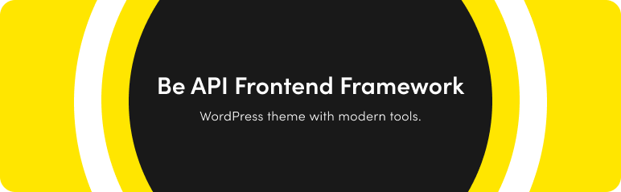

# Be API FrontEnd Framework

[](https://beapi.fr)

[](https://GitHub.com/Naereen/StrapDown.js/graphs/commit-activity)

## Qu’est-ce que BFF ?

**Be API Frontend Framework** *(ou BFF)* est un boilerplate de thème WordPress conçu pour vous aider à lancer votre propre thème WordPress avec des outils modernes.

## Prérequis

### PHP et WordPress

- PHP **8.3** ou supérieur
- WordPress **6.3** ou supérieur

### Composer

Composer est nécessaire pour autoloader toutes vos classes depuis le dossier `inc`.

Utilisez le package `beapi/composer-scaffold-theme`, qui l’ajoute automatiquement au fichier `composer.json`.
Vous pouvez aussi l’ajouter vous-même ainsi :

```composer.json
    "autoload": {
        "psr-4": {
            "BEA\\Theme\\Framework\\": "content/themes/framework/inc/"
        }
    }
```

### Autoload

L’autoload repose sur PSR-4 et est géré par Composer.

### Node.js

Vous avez besoin de [la dernière version stable de Node.js](https://nodejs.org/).

## Installation

Téléchargez la dernière release de BFF [ici](https://github.com/BeAPI/beapi-frontend-framework/releases) et extrayez l’archive zip dans le dossier `themes` de WordPress.

```bash
|____wp-admin
|____wp-content
| |____plugins
| |____themes
| | |____beapi-frontend-framework
| |____uploads
|____wp-includes
```

Vous pouvez bien sûr renommer `beapi-frontend-framework` pour définir le nom de votre thème WordPress.

Ensuite, rendez-vous dans le dossier du thème (dans l’exemple ci-dessous, je n’ai pas renommé `beapi-frontend-framework`) avec votre terminal préféré.

```bash
cd wp-content/themes/beapi-frontend-framework
```

Puis installez les dépendances Node avec Yarn.

```bash
yarn
```

Vous pouvez aussi utiliser NPM.

```bash
npm install
```

## Développement local avec wp-env

BFF inclut une configuration [wp-env](https://developer.wordpress.org/block-editor/reference-guides/packages/packages-env/) (`.wp-env.json`) pour exécuter une instance WordPress locale avec Docker.

### Prérequis

- [Docker Desktop](https://www.docker.com/products/docker-desktop/) (ou un runtime Docker compatible)
- Node.js (voir [Prérequis](#nodejs))

### Installation de wp-env

Vous pouvez lancer wp-env sans installation globale via `npx @wordpress/env`, ou installer la CLI une fois et utiliser la commande `wp-env` :

```bash
# Global install (npm or yarn)
npm install -g @wordpress/env
# ou
yarn global add @wordpress/env
```

Après l’installation, remplacez `npx @wordpress/env` par `wp-env` dans les commandes ci-dessous.

### Démarrage

Depuis la racine du thème :

```bash
yarn
npx @wordpress/env start
# ou, si wp-env est installé globalement :
wp-env start
```

Au premier démarrage, wp-env va :

- Démarrer WordPress (PHP 8.3)
- Monter ce thème depuis le répertoire courant
- Installer et activer l’extension [Advanced Custom Fields](https://wordpress.org/plugins/advanced-custom-fields/)

### URLs et identifiants

| | |
|---|---|
| Site | http://localhost:8888 |
| Admin | http://localhost:8888/wp-admin |
| Identifiant | `admin` |
| Mot de passe | `password` |

### Commandes courantes

```bash
# Démarrer l’environnement
npx @wordpress/env start   # ou : wp-env start

# Arrêter les conteneurs (les données sont conservées)
npx @wordpress/env stop    # ou : wp-env stop

# Supprimer conteneurs et volumes
npx @wordpress/env destroy # ou : wp-env destroy

# Exécuter WP-CLI dans l’environnement
npx @wordpress/env run cli wp plugin list
# ou : wp-env run cli wp plugin list

# Exécuter une commande dans le dossier du thème
npx @wordpress/env run cli --env-cwd=wp-content/themes/beapi-frontend-framework composer install
# ou : wp-env run cli --env-cwd=wp-content/themes/beapi-frontend-framework composer install
```

### Workflow de développement

Avec wp-env en cours d’exécution, lancez le watcher Webpack dans un second terminal :

```bash
yarn start
```

Les changements sur les assets PHP, SCSS et JavaScript sont pris en compte après rebuild Webpack. Les modifications PHP du thème sont appliquées immédiatement grâce au volume monté.

## Configuration

Les fichiers de configuration se trouvent dans le dossier `config`.

### Webpack

Vous trouverez le fichier de paramètres Webpack communs dans `webpack.common.js`. Pour le mode développement, éditez `webpack.dev.js` ; pour la production, `webpack.prod.js`.
Les loaders sont dans `loaders.js` et les plugins Webpack dans `plugins.js`.

## Comment utiliser BFF ?

Après l’installation des dépendances, vous pouvez exécuter les commandes décrites ci-dessous.

### Démarrer avec Browser Sync

BFF est configuré pour fonctionner avec [Lando](https://lando.dev/). Si vous avez un fichier `.lando.yml` à la racine de votre projet, indiquez le chemin vers ce fichier dans `browsersync.config.js`.

```js
let fileContents = fs.readFileSync('../../../../.lando.yml', 'utf8')
```

Puis exécutez la commande suivante depuis le thème :

```bash
yarn start
```

BrowserSync proxifiera votre serveur Lando d’après le nom défini dans votre `.lando.yml`.

### Build

```bash
yarn build
```

### Rapport de bundle

Vous pouvez générer un rapport de bundle avec la commande suivante :

```bash
yarn bundle-report
```

## Core Web Vitals

### Ce que le thème fournit

- **Image LCP** : passez `'is_lcp' => true` dans les réglages de `get_the_image()` pour l’image principale above-the-fold (hero, couverture). Cela retire `loading="lazy"` et ajoute `fetchpriority="high"` et `decoding="sync"`. À utiliser sur une seule image par page.

```php
the_image( $image_id, [ 'alt' => '' ], [ 'size' => 'hero', 'is_lcp' => true ] );
```

- **Images décoratives** : passez `'alt' => ''` pour produire `alt=""`, afin que les technologies d’assistance ignorent l’image. Omettre `alt` n’est pas équivalent.
- **Images statiques du thème** (logos, placeholders, illustrations depuis `dist/`) : utilisez `get_theme_static_image_markup()` / `the_theme_static_image()`. `width` et `height` sont lus depuis le fichier (SVG ou raster) pour limiter les décalages de mise en page (CLS).

```php
the_theme_static_image( 'dist/images/placeholder.svg', [ 'class' => 'card__image', 'loading' => 'lazy' ] );
```

- **Logo personnalisé** : reçoit `fetchpriority="low"` pour ne pas concurrencer la vraie image LCP.
- **Preload des polices** : opt-in, uniquement pour les polices rendues au premier affichage.

```php
add_filter( 'bea_theme_framework_preload_fonts', fn() => [ 'dist/fonts/my-font-regular.woff2' ] );
```

- **JS** : `Animation` s’appuie sur `IntersectionObserver` (pas de boucle au scroll). Utilisez `deferInitialization()` depuis `src/js/utils` pour exécuter du code non critique lorsque le navigateur est inactif (INP).

### Ce que chaque projet doit encore configurer

Cela dépend de l’hébergement, des extensions et du contenu ; ce n’est donc pas inclus dans le thème :

- Cache de page et réglages WP Rocket (Remove Unused CSS, defer / delay JS et leurs exclusions, exclusions lazyload pour l’image LCP, preconnect limités aux tiers chargés tôt).
- `robots.txt` (endpoints techniques et AJAX) et en-têtes `Cache-Control` pour les assets statiques.
- Réglages du plugin SEO : URLs canoniques sur pagination personnalisée, doublons de données structurées.
- Polices : sous-ensemble des fichiers aux graisses et glyphes réellement utilisés, suppression des fichiers inutiles (italiques, graisses supplémentaires).
- Intégrations tierces (vidéos, formulaires, webinars) : chargement à l’interaction ou à l’entrée dans le viewport.
- Assets des plugins : dequeue des scripts et styles front sur les pages qui ne les utilisent pas.

## Éditeur WordPress (Gutenberg)

### Personnaliser les blocs

Le filtre `bff_editor_custom_settings` permet de personnaliser les styles et variations de blocs. Par exemple :

```php
add_filter( 'bff_editor_custom_settings', 'customize_editor_settings', 10, 1 );
function customize_editor_settings( $settings ) {
	// Disable all block styles for Separator block
	$settings[ 'disableAllBlocksStyles' ] = [ 'core/separator' ];

	// Disable specific block style for Button block
	$settings[ 'disabledBlocksStyles' ]   = [ 'core/button' => [ 'outline' ] ];

	// Allow only YouTube variation for Embed block
	$settings[ 'allowedBlocksVariations' ] = [ 'core/embed' => [ 'youtube' ] ];

	return $settings;
}
```
